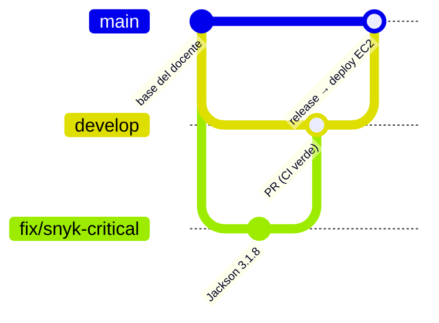
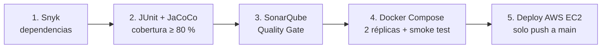

# MiniBiblioteca DevSecOps

[](https://github.com/goCatrilef/project-library-devops/actions/workflows/ci-cd.yml)

| | |
|---|---|
| **Asignatura** | Ingeniería DevOps (DOY0101) |
| **Evaluación** | Parcial N°2 — *Añadiéndole complejidad a nuestro pipeline* |
| **Autor** | Gonzalo Catrilef F. (trabajo individual) |
| **Aplicación desplegada** | `http://98.80.71.90` |

Microservicio Spring Boot con frontend Nginx, contenerizado con Docker y orquestado con Docker Compose. Un pipeline CI/CD en **GitHub Actions** ejecuta análisis de dependencias, pruebas con cobertura mínima, análisis estático, construcción de imágenes con smoke test y despliegue automático en **AWS EC2**.

---

## Índice

1. [Cumplimiento de la pauta](#1-cumplimiento-de-la-pauta)
2. [Arquitectura](#2-arquitectura)
3. [Estrategia de ramas y flujo de trabajo](#3-estrategia-de-ramas-y-flujo-de-trabajo)
4. [El pipeline CI/CD](#4-el-pipeline-cicd)
5. [IE1 · Contenedores](#5-ie1--contenedores)
6. [IE2 · Pruebas y política de calidad](#6-ie2--pruebas-y-política-de-calidad)
7. [IE3 · Seguridad y escalabilidad](#7-ie3--seguridad-y-escalabilidad)
8. [IE4 · Despliegue automático y trazabilidad](#8-ie4--despliegue-automático-y-trazabilidad)
9. [IE5 · Orquestación con Docker Compose](#9-ie5--orquestación-con-docker-compose)
10. [Evidencia: cada etapa falla y pasa](#10-evidencia-cada-etapa-falla-y-pasa)
11. [Ejecución local y operación](#11-ejecución-local-y-operación)
12. [Justificación técnica de las decisiones](#12-justificación-técnica-de-las-decisiones)
13. [Declaración de uso de IA](#13-declaración-de-uso-de-inteligencia-artificial)
14. [Conclusiones y reflexión personal](#14-conclusiones-y-reflexión-personal)

---

## 1. Cumplimiento de la pauta

| Requisito del encargo | Indicador | Implementación |
|---|---|---|
| Dockerfile del microservicio | IE1 | `backend/Dockerfile` multi-stage y `frontend/Dockerfile` |
| Construcción de imagen en el pipeline | IE1 | Job **4. Docker Compose y Smoke Test** |
| Pruebas unitarias (JUnit / Mockito) | IE2 | 12 pruebas y cobertura mínima de 80 % con JaCoCo (job **2**) |
| Análisis con Snyk y SonarQube | IE3 | Jobs **1. Snyk** y **3. SonarQube Cloud** |
| Bloqueos si el análisis de seguridad falla | IE3 | Security Gate de Snyk, Quality Gate de Sonar y protección de ramas con checks obligatorios |
| Parámetros de escalabilidad | IE3 / IE5 | Réplicas parametrizables, límites de CPU y memoria, balanceo con Nginx |
| Despliegue automático en un entorno cloud | IE4 | Job **5. Deploy AWS EC2** en cada push a `main` |
| Orquestación de contenedores | IE5 | `docker-compose.yml` |
| Documentar el pipeline, la trazabilidad y la calidad | IE4 | Este README |

> **Dependabot:** se retiró del proyecto por indicación del docente (no se evalúa en esta EP). El escaneo de dependencias lo realiza **Snyk**.

---

## 2. Arquitectura

```mermaid
flowchart LR
    U[Navegador] -->|HTTP :80| F[frontend<br/>Nginx]
    F -->|/api/* round-robin| B1[backend-1<br/>Spring Boot 4 / Java 21]
    F -->|/api/*| B2[backend-N]
    subgraph EC2 · Docker Compose · red minibiblioteca-net
      F
      B1
      B2
    end
```

| Componente | Tecnología | Función |
|---|---|---|
| frontend | HTML/CSS/JS + Nginx | Sirve la web y reenvía `/api/*` al backend (proxy inverso y balanceador) |
| backend | Spring Boot 4.1.2 + Java 21 | API REST |
| persistencia | Repositorio en memoria | Evita un contenedor de base de datos en una EC2 de 1 GiB |
| CI/CD | GitHub Actions | `.github/workflows/ci-cd.yml` |
| Producción | AWS EC2 (Amazon Linux 2023) | Solo ejecuta contenedores; no compila |

| Método | Ruta | Descripción |
|---|---|---|
| GET | `/api/libros` | Lista los libros |
| GET | `/api/libros/{id}` | Busca un libro (404 si no existe) |
| GET | `/api/resumen` | Total de libros y disponibles |
| GET | `/api/health` | Estado del servicio (healthchecks y smoke tests) |

---

## 3. Estrategia de ramas y flujo de trabajo



| Rama | Rol | Protección |
|---|---|---|
| `main` | Producción. Cada push despliega en EC2 | Solo mediante PR, con los 4 checks obligatorios en verde |
| `develop` | Integración | Solo mediante PR, con los 4 checks obligatorios en verde |
| `fix/*`, `feature/*` | Una corrección o mejora por rama | — |

Cada cambio sigue el mismo camino: **rama → PR hacia `develop` → pipeline → merge → PR de release `develop → main` → pipeline + deploy**. Las reglas de protección exigen los checks `1. Snyk`, `2. JUnit Mockito y JaCoCo`, `3. SonarQube Cloud` y `4. Docker Compose y Smoke Test`. Si alguno falla, **el botón de merge queda bloqueado**.

---

## 4. El pipeline CI/CD



| Evento | Qué se ejecuta |
|---|---|
| Pull request hacia `develop` o `main` | Jobs 1 a 4 (el job 5 queda *Skipped*) |
| Push a `develop` | Jobs 1 a 4 |
| Push a `main` | Jobs 1 a 5: incluye el despliegue |
| `workflow_dispatch` | Ejecución manual |

Los jobs se encadenan con `needs`: si una etapa falla, las siguientes quedan en *Skipped* y nada defectuoso llega a producción.

| # | Job | Qué hace | Bloquea si… |
|---|---|---|---|
| 1 | Snyk - Dependencias | Análisis SCA de `backend/pom.xml`; publica `snyk-report.json` | hay una vulnerabilidad **Critical** |
| 2 | JUnit Mockito y JaCoCo | `mvn clean verify`: pruebas, reporte y `jacoco:check` | falla una prueba o la cobertura de líneas es < 80 % |
| 3 | SonarQube Cloud | Análisis estático con la cobertura de JaCoCo; espera el Quality Gate | el Quality Gate no se cumple |
| 4 | Docker Compose y Smoke Test | Construye las imágenes etiquetadas con el SHA, levanta el stack con **2 réplicas**, prueba `/api/health` y `/api/libros`, verifica que las 2 réplicas estén *healthy* y empaqueta las imágenes | el stack no responde o no hay 2 réplicas sanas |
| 5 | Deploy AWS EC2 | Copia el paquete por SSH/SCP, ejecuta `docker load` y `docker compose up --no-build`, y verifica `/api/health` | la EC2 no está preparada o la app no responde |

**Concurrencia:** `group: ${{ github.workflow }}-${{ github.ref }}`. Cada rama tiene su propia cola y solo se cancelan ejecuciones antiguas en los PR, así que un despliegue en `main` nunca se interrumpe a la mitad.

### Configuración en GitHub (`Settings → Secrets and variables → Actions`)

| Tipo | Nombre | Uso |
|---|---|---|
| Secret | `SNYK_TOKEN` | Autenticación de Snyk |
| Secret | `SONAR_TOKEN` | Autenticación de SonarQube Cloud |
| Variable | `SONAR_PROJECT_KEY` | Clave del proyecto en SonarQube Cloud |
| Variable | `SONAR_ORGANIZATION` | Organización en SonarQube Cloud |
| Secret | `AWS_HOST` | IP pública de la EC2 |
| Secret | `AWS_USER` | `ec2-user` |
| Secret | `AWS_SSH_KEY` | Llave privada `.pem` completa |

En SonarQube Cloud, **Automatic Analysis está desactivado**: el análisis lo ejecuta el pipeline después de las pruebas, para incluir la cobertura de JaCoCo.

---

## 5. IE1 · Contenedores

| Imagen | Construcción |
|---|---|
| `minibiblioteca-backend` | **Multi-stage**: la etapa `maven:3.10-eclipse-temurin-21-alpine` compila y la imagen final usa solo `eclipse-temurin:21-jre-alpine`, sin Maven ni JDK. Se copia `pom.xml` antes que `src` para cachear las dependencias. Se ejecuta con el usuario `app`, **sin privilegios de root** |
| `minibiblioteca-frontend` | `nginxinc/nginx-unprivileged:alpine`: la Nginx oficial ejecutándose con un usuario **sin privilegios** (uid 101) en el puerto 8080. Docker mapea `80 → 8080`, así que desde afuera se sigue accediendo por el puerto 80 |

Las imágenes se construyen en GitHub Actions y viajan a la EC2 empaquetadas con `docker save`. **La EC2 nunca compila ni construye imágenes**; eso permite operar en una instancia de 1 GiB de RAM.

---

## 6. IE2 · Pruebas y política de calidad

### Política de calidad

1. **Toda prueba debe pasar.** Una sola falla detiene el pipeline.
2. **Cobertura mínima de líneas de 80 %**, definida en `backend/pom.xml` (`jacoco.minimo.lineas`) y aplicada por `jacoco:check` en la fase `verify`. La clase `MiniBibliotecaApplication` se excluye porque solo arranca Spring.
3. **Quality Gate de SonarQube Cloud** sobre el código nuevo.
4. **Nada se construye ni se despliega** si fallan las etapas anteriores.

### Pruebas

| Clase | Tipo | Casos cubiertos |
|---|---|---|
| `LibroServiceTest` | Unitaria con Mockito | Listado, búsqueda por id, id inexistente → excepción, conteo de disponibles |
| `LibroControllerTest` | Capa HTTP con MockMvc | Respuestas 200, **404 (y no 500) ante un id inexistente**, cálculo del resumen, `/api/health` |
| `LibroRepositoryMemoriaTest` | Unitaria | Catálogo inicial, búsqueda, id inexistente |

El reporte de JaCoCo se publica como artefacto (`jacoco-backend`) en cada ejecución, y SonarQube Cloud comenta el resultado del Quality Gate en cada PR.

---

## 7. IE3 · Seguridad y escalabilidad

### Seguridad

| Capa | Control |
|---|---|
| Dependencias | **Snyk** con Security Gate: bloquea ante vulnerabilidades Critical y publica el reporte JSON |
| Código | **SonarQube Cloud** con Quality Gate bloqueante (`sonar.qualitygate.wait=true`) |
| Ramas | Protección de `main` y `develop`: merge solo con PR y checks en verde |
| Vulnerabilidad corregida | **CVE-2026-110879** (Critical, CVSS 9.3): deserialización insegura en `jackson-databind 3.1.7`, que llegaba de forma transitiva desde Spring Boot 4.1.2. Se fijó `jackson-bom.version=3.1.8` en el `pom.xml` |
| Secretos | Tokens y llave SSH solo en GitHub Secrets; `.env` y `*.pem` en `.gitignore` |
| Pipeline | `permissions: contents: read` (mínimo privilegio) |
| Contenedores | **Ningún contenedor se ejecuta como root**: el backend con el usuario `app` y el frontend con `nginx-unprivileged`. El backend no publica puertos hacia el exterior |
| Red (AWS) | Security Group con solo **22/TCP** (SSH) y **80/TCP** (HTTP). Los puertos 8080 y 443 están cerrados |

### Escalabilidad y desempeño

| Parámetro | Valor | Propósito |
|---|---|---|
| `deploy.replicas` (backend) | `${BACKEND_REPLICAS:-1}` | Escalado horizontal: CI despliega **2** y la EC2 Free Tier 1 |
| Balanceo | Nginx + DNS de Docker (`resolver 127.0.0.11 valid=10s`) | Reparte `/api/*` entre réplicas y detecta réplicas nuevas |
| Tolerancia a fallos | `proxy_next_upstream error timeout http_502 http_503` | Si una réplica falla, la petición se reintenta en otra |
| Límites backend | `mem_limit: 480m`, `cpus: 0.60` | Evita que un servicio acapare la VM |
| Límites frontend | `mem_limit: 96m`, `cpus: 0.20` | Nginx es liviano |
| JVM | `-Xms64m -Xmx256m -XX:MaxMetaspaceSize=128m -XX:+UseSerialGC` | Memoria acotada para 1 GiB |
| Swap en EC2 | 1 GiB | Respaldo ante picos de memoria |

---

## 8. IE4 · Despliegue automático y trazabilidad

### Despliegue

Cada push a `main` (merge de un PR de release) ejecuta el job 5:

1. **Verificar EC2 preparada:** comprueba `/opt/minibiblioteca/.bootstrap-ready`, Docker y Compose.
2. **Copiar** por SCP las imágenes, `docker-compose.yml` y `.env`, que contiene `APP_VERSION=<SHA>`.
3. **Cargar y levantar:** ejecuta `docker load` y `docker compose up -d --no-build`.
4. **Verificar:** consulta `/api/health` desde la propia EC2.

La EC2 se preparó una sola vez siguiendo `deploy/prepare-ec2.sh`: Docker, Compose v5.6.1, swap, carpetas y la marca `.bootstrap-ready`.

### Trazabilidad: del commit a producción

```
commit ─► PR (revisión + checks) ─► run de Actions ─► imágenes :<SHA> ─► deploy EC2 con APP_VERSION=<SHA>
```

| Eslabón | Cómo se rastrea |
|---|---|
| Cambio → motivo | Cada cambio tiene su rama, su commit con mensaje convencional (`fix:`, `feat:`, `test:`) y su PR con descripción |
| PR → validación | Cada PR guarda los checks ejecutados, el comentario de SonarQube y los artefactos |
| Commit → imagen | Las imágenes se etiquetan con el SHA del commit: `minibiblioteca-backend:<SHA>`. No se usa `latest` |
| Imagen → producción | El `.env` de la EC2 contiene `APP_VERSION=<SHA>`; `docker compose ps` en la EC2 muestra qué commit está corriendo |
| Evidencia | Artefactos de cada run (`snyk-report`, `jacoco-backend`, `minibiblioteca-deploy`) y el historial en la pestaña *Actions* |

Para saber qué versión corre en producción:
```bash
cat /opt/minibiblioteca/current/.env
sudo docker compose -f /opt/minibiblioteca/current/docker-compose.yml ps
```

---

## 9. IE5 · Orquestación con Docker Compose

| Mecanismo | Configuración | Resultado |
|---|---|---|
| Healthchecks | backend `/api/health`, frontend `/` (puerto 8080 interno) | Docker conoce el estado real de cada servicio |
| Orden de arranque | `depends_on: condition: service_healthy` | El frontend arranca solo cuando el backend está sano |
| Réplicas | `deploy.replicas`, sin `container_name` en el backend | Escalado con un solo parámetro |
| Recursos | `mem_limit` y `cpus` | Convivencia estable en una VM pequeña |
| Autorecuperación | `restart: unless-stopped` + `systemctl enable docker` | Tras reiniciar la EC2, la aplicación volvió sola |
| Red | Bridge dedicada `minibiblioteca-net` | Descubrimiento por nombre (`backend:8080`) y aislamiento |
| Configuración | `APP_VERSION`, `APP_PORT`, `BACKEND_REPLICAS` | El mismo archivo sirve en local, en CI y en EC2 |

```bash
BACKEND_REPLICAS=3 docker compose up -d   # escalar manualmente
```

---

## 10. Evidencia: cada etapa falla y pasa

| # | Situación | Etapa que bloqueó | Corrección | PR |
|---|---|---|---|---|
| 1 | Pipeline sin tokens configurados | Snyk / Sonar (error técnico) | Secrets y variables en GitHub | — |
| 2 | **CVE-2026-110879** Critical en `jackson-databind 3.1.7` | 1. Snyk – Security Gate | `fix(security)`: Jackson 3.1.8 | #10 |
| 3 | Los PR de Dependabot se cancelaban entre sí (`concurrency` compartido) | Pipeline cancelado | `fix(ci)`: concurrency por rama | #11 |
| 4 | `.env` excluido del artefacto (`upload-artifact` v4.4 omite archivos ocultos) | 5. Deploy – SCP | `fix(cd)`: `include-hidden-files: true` | #12 |
| 5 | Cobertura bajo el 80 % al activar la política | 2. JUnit y JaCoCo (merge bloqueado) | `test`: pruebas de controller y repositorio | #14 |
| 6 | `nginx.conf` sin la llave de cierre de `server` | 4. Smoke test | `fix(nginx)`: cerrar el bloque | #15 |


---

## 11. Ejecución local y operación

```bash
mvn -f backend/pom.xml clean verify                      # pruebas + cobertura
APP_VERSION=local APP_PORT=8088 BACKEND_REPLICAS=2 docker compose up -d --build
curl http://127.0.0.1:8088/api/health
docker compose down
```

En la EC2:
```bash
cd /opt/minibiblioteca/current
sudo docker compose ps
sudo docker compose logs --tail=100 backend
sudo docker stats --no-stream
```

---


## 12. Justificación técnica de las decisiones. 
¿Por qué fijar Jackson 3.1.8 en el pom.xml en vez de esperar a que Spring Boot lo actualice?
La decisión de agregar Jackson directamente en el pom.xml fue para corregir la vulnerabilidad detectada por Snyk, ya que el reporte indicaba que aún no existía una versión de Spring Boot que solucionara el problema. Por este motivo, decidimos actualizar la dependencia directamente para mantener el entorno de producción protegido frente a posibles ciberataques.

¿Por qué la EC2 no compila y solo recibe imágenes ya construidas?
Porque compilar Maven directamente en la instancia EC2 podría agotar sus recursos y afectar el funcionamiento de la aplicación en producción. Esta decisión es una medida de protección para evitar el consumo innecesario de recursos y mantener la estabilidad del servicio.
Por eso, decidimos que la EC2 solo reciba las imágenes previamente construidas y se encargue de ejecutarlas.

¿Por qué un 80% de cobertura y por qué tiene que bloquear el build?
El 80% es un umbral de cobertura utilizado habitualmente como referencia para evaluar las pruebas del código. La cobertura de líneas corresponde al porcentaje de líneas ejecutables que se ejecutan al menos una vez durante las pruebas.

Por ejemplo, si tenemos un 35% de cobertura, significa que el 65% de las líneas ejecutables no fue cubierto por las pruebas, lo que podría dejar errores sin detectar.

El bloqueo permite hacer cumplir esta exigencia, deteniendo el pipeline y marcando el build como fallido cuando no se alcanza el mínimo establecido. Así, la calidad del código no depende solamente de que alguien recuerde revisar los resultados.

¿Por qué cada cambio en su propia rama y su propio PR?
Es importante mantener un registro de los cambios realizados en el proyecto. Cada rama debe tener un objetivo específico, lo que permite identificar con mayor facilidad dónde se produjo un error.

Esta trazabilidad nos ayuda a registrar qué se modificó, por qué se realizó el cambio y cuándo se implementó, facilitando la detección y corrección de errores en producción.

La rama develop permite validar la integración de los cambios antes de llegar a main, verificando su correcto funcionamiento. Finalmente, main recibe los cambios aprobados desde develop y permite realizar el despliegue a producción.


## 13. Declaración de uso de Inteligencia Artificial

| Herramienta | Uso | Validación |
|---|---|---|
| Claude (Anthropic) | Apoyo para diagnosticar fallas del pipeline,  proponer configuraciones (JaCoCo,Nginx, workflow), redactar las pruebas unitarias adicionales, organizar la documentación descriptiva de este README y corrección ortográfica de las secciones 12 y 14 | Cada cambio lo apliqué y lo validé en mi rama, con su PR y la ejecución del pipeline en GitHub Actions |

Las secciones 12 (justificación técnica) y 14 (conclusiones y reflexión personal) fueron redactadas por el autor; la IA solo se usó para su corrección ortográfica.

**Referencia:**
Anthropic. (2026). *Claude* 

## 14. Conclusiones y reflexión personal

¿Qué aprendiste que no sabías antes de hoy?

Uno de los desafíos más importantes fue resolver la vulnerabilidad crítica detectada por Snyk. Aprendí a interpretar el reporte de seguridad e implementar la remediación correspondiente para que el pipeline pudiera continuar con la siguiente etapa.

Por otra parte, mi experiencia previa trabajando con AWS me ayudó a resolver con mayor rapidez los problemas que se presentaron cuando el entorno de AWS Learner Lab se apagó y cambió la dirección IP de la instancia EC2.

Como mejora futura, considero importante separar el frontend del backend para que ambos puedan desplegarse y administrarse de forma independiente.

Una alternativa sería implementar el frontend en Amazon S3 con CloudFront y mantener el backend contenerizado dentro de una VPC en AWS, utilizando Amazon EKS para su orquestación mediante Kubernetes.

Esto permitiría mejorar la escalabilidad, la disponibilidad y el control de los despliegues, evitando que una actualización de un componente afecte innecesariamente al resto de la aplicación.

